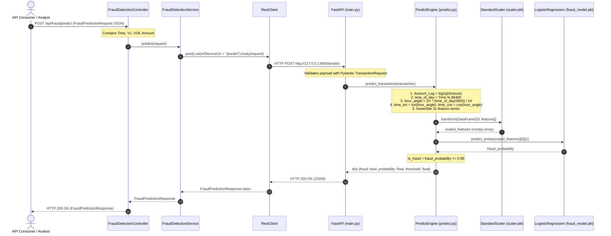
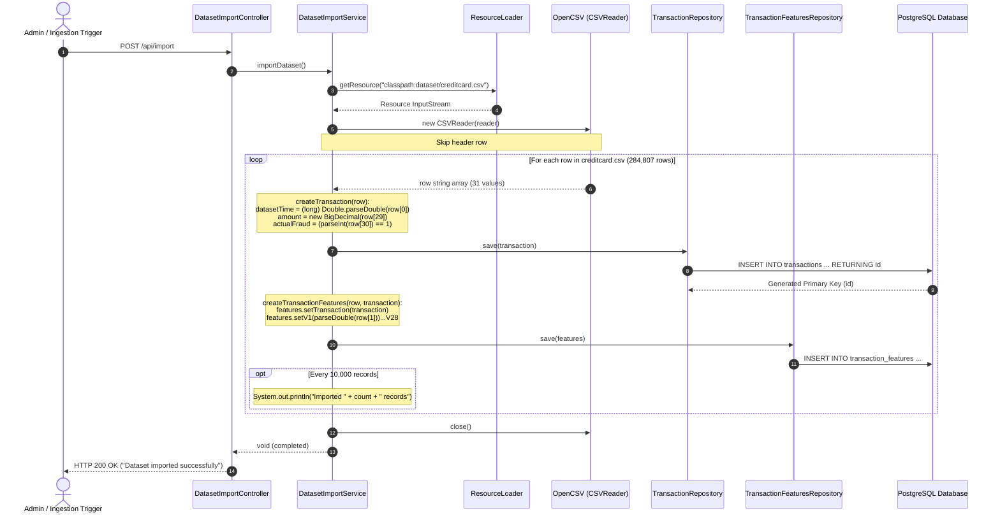

# ARCHITECTURE AND EXECUTION FLOW

This document details the system topology, component interactions, and execution flows supported directly by the codebase.

---

## 1. System Architecture Diagram

The system follows a multi-tier microservice architecture consisting of the Spring Boot application, PostgreSQL relational store, and FastAPI machine learning engine.

```mermaid
graph TB
    subgraph Client Tier
        Client["Client / HTTP Consumer (cURL / Postman / Browser)"]
    end

    subgraph Backend Microservice ["Spring Boot Backend (Port 8080)"]
        TC["TransactionController\n/api/transactions"]
        DC["DashboardController\n/api/dashboard"]
        FDC["FraudDetectionController\n/api/fraud"]
        DIC["DatasetImportController\n/api/import"]
        
        TS["TransactionService"]
        DS["DashboardService"]
        FDS["FraudDetectionService"]
        DIS["DatasetImportService"]
        
        TR["TransactionRepository"]
        TFR["TransactionFeaturesRepository"]
        PR["PredictionRepository"]
        
        GEH["GlobalExceptionHandler\n(@ControllerAdvice)"]
        RC["RestClient\n(RestClientConfig)"]
    end

    subgraph Persistence Tier ["PostgreSQL Database (Port 5432)"]
        T_TABLE[("transactions")]
        TF_TABLE[("transaction_features")]
        P_TABLE[("predictions")]
    end

    subgraph ML Microservice ["Python FastAPI Microservice (Port 8000)"]
        FA["FastAPI App\n(main.py)"]
        EP["Endpoints:\nGET /\nPOST /predict"]
        PP["Prediction Engine\n(predict.py)"]
        FE["Feature Engineering:\nAmount_Log = log1p(Amount)\ntime_sin, time_cos"]
        SC["StandardScaler\n(scaler.pkl)"]
        MDL["Logistic Regression Model\n(fraud_model.pkl)"]
        TH["Threshold Comparison\n(threshold.pkl = 0.95)"]
    end

    %% Client Routing
    Client -->|HTTP GET /api/transactions| TC
    Client -->|HTTP GET /api/transactions/search| TC
    Client -->|HTTP GET /api/transactions/{id}| TC
    Client -->|HTTP GET /api/dashboard/*| DC
    Client -->|HTTP POST /api/fraud/predict| FDC
    Client -->|HTTP POST /api/import| DIC

    %% Controllers to Services
    TC --> TS
    DC --> DS
    FDC --> FDS
    DIC --> DIS

    %% Services to Repositories
    TS --> TR
    DS --> TR
    DIS --> TR
    DIS --> TFR

    %% Repositories to PostgreSQL Tables
    TR -->|JPA / SQL Queries| T_TABLE
    TFR -->|JPA / SQL Queries| TF_TABLE
    PR -.->|Unused in active flow| P_TABLE

    %% Inter-service HTTP Call
    FDS -->|HTTP POST /predict| RC
    RC -->|JSON Request Payload| FA
    FA --> EP
    EP --> PP
    PP --> FE
    FE --> SC
    SC --> MDL
    MDL --> TH
    TH -->|JSON Prediction Response| FA
    FA -->|fraud, probability, threshold| RC

    %% Exception Handling
    TC -.->|Validation / Not Found Errors| GEH
    GEH -.->|Structured Error Response| Client
```

---

## 2. Sequence Diagram: Machine Learning Fraud Prediction Flow

This diagram illustrates how an incoming transaction feature payload is validated, proxied to the Python ML microservice, engineered, standardized, evaluated against the trained model, and returned to the caller.



---

## 3. Sequence Diagram: CSV Dataset Ingestion Flow

This diagram illustrates how transaction data is imported from the local CSV dataset into PostgreSQL.



---

## 4. Sequence Diagram: Dynamic Transaction Query & Specification Flow

This diagram illustrates how client queries with optional filters (e.g., amount range and fraud status) are executed via Spring Data JPA Criteria Specifications.

```mermaid
sequenceDiagram
    autonumber
    actor Client as API Consumer / Dashboard
    participant TC as TransactionController
    participant TS as TransactionService
    participant Spec as TransactionSpecification
    participant TR as TransactionRepository
    participant DB as PostgreSQL Database

    Client->>TC: GET /api/transactions/search?minAmount=100&maxAmount=500&fraud=true&page=0&size=10&sortBy=amount&direction=desc
    
    Note over TC: Validates @PositiveOrZero on min/max amount<br/>Validates @Min(0) on page, @Min(1) on size
    TC->>TS: searchTransactions(minAmount, maxAmount, fraud, page, size, sortBy, direction)
    
    Note over TS: Constructs Pageable:<br/>Sort.by("amount").descending()<br/>PageRequest.of(0, 10, sort)
    
    TS->>Spec: hasAmountBetween(minAmount, maxAmount)
    Spec-->>TS: Specification<Transaction> (cb.between)
    
    TS->>Spec: hasFraudStatus(true)
    Spec-->>TS: Specification<Transaction> (cb.equal)
    
    TS->>TR: findAll(specification, pageable)
    TR->>DB: SELECT * FROM transactions WHERE amount BETWEEN 100 AND 500 AND actual_fraud = true ORDER BY amount DESC LIMIT 10 OFFSET 0;<br/>SELECT COUNT(*) FROM transactions WHERE amount BETWEEN 100 AND 500 AND actual_fraud = true;
    DB-->>TR: Page<Transaction>
    
    Note over TS: mapToDto(transaction):<br/>Converts entity into TransactionResponseDto
    TS-->>TC: Page<TransactionResponseDto>
    TC-->>Client: HTTP 200 OK (Page<TransactionResponseDto> JSON)
```

---

## 5. Traceability Matrix: Use Cases to Code Symbols

| Use Case | Controller & Method | Service & Method | Repository & Query | Database Tables | External Calls |
|---|---|---|---|---|---|
| **1. Ingest Dataset** | `DatasetImportController.importDataset()` | `DatasetImportService.importDataset()` | `TransactionRepository.save()`, `TransactionFeaturesRepository.save()` | `transactions`, `transaction_features` | None (Local CSV stream) |
| **2. Paginated Query** | `TransactionController.getTransactions()` | `TransactionService.getTransactions()` | `TransactionRepository.findAll(Pageable)` or `findByActualFraud(Boolean, Pageable)` | `transactions` | None |
| **3. Filter by Criteria** | `TransactionController.searchTransactions()` | `TransactionService.searchTransactions()` | `TransactionRepository.findAll(Specification, Pageable)` via `TransactionSpecification` | `transactions` | None |
| **4. Get Single Record** | `TransactionController.getTransactionById()` | `TransactionService.getTransactionById()` | `TransactionRepository.findById(Long)` | `transactions` | None |
| **5. Overall Summary** | `DashboardController.getSummary()` | `DashboardService.getSummary()` | `TransactionRepository.count()`, `countByActualFraud(true)` | `transactions` | None |
| **6. Amount Summary** | `DashboardController.getAmountSummary()` | `DashboardService.getAmountSummary()` | `TransactionRepository.findTotalAmount()`, `findFraudAmount()`, `findGenuineAmount()` | `transactions` | None |
| **7. Recent Frauds** | `DashboardController.getRecentFrauds()` | `DashboardService.getRecentFrauds()` | `TransactionRepository.findTop10ByActualFraudTrueOrderByDatasetTimeDesc()` | `transactions` | None |
| **8. Status Summary** | `DashboardController.getStatusSummary()` | `DashboardService.getStatusSummary()` | `TransactionRepository.countTransactionsByProcessingStatus()` | `transactions` | None |
| **9. Model Prediction** | `FraudDetectionController.predict()` | `FraudDetectionService.predict()` | None (stateless HTTP proxy) | None | `POST http://127.0.0.1:8000/predict` |
| **10. Global Error Handling** | `GlobalExceptionHandler` | Spring Web MVC interceptor | N/A | N/A | None |
